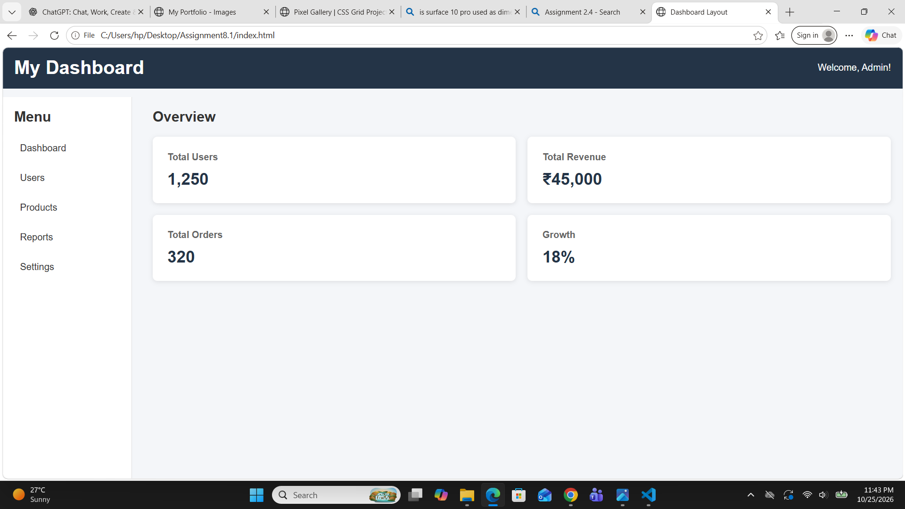

# Assignment 8.1 — Dashboard-Style Grid Layout

## 1. Aim

The aim of this assignment is to learn how to create a basic dashboard layout using CSS Grid. It focuses on arranging a header, sidebar, main content area, and statistic cards using grid rows, columns, and gaps.

## 2. Introduction

CSS (Cascading Style Sheets) is used to control the layout and appearance of webpages. CSS Grid is a powerful layout system that allows developers to arrange elements in rows and columns.

In this assignment, a dashboard-style webpage is created with a header, a sidebar, a main content area, and three or four statistic cards. CSS Grid is used to organize these components into a structured and visually appealing layout.

## 3. Theory of CSS Grid

CSS Grid is a two-dimensional layout system that allows webpage elements to be arranged along both horizontal and vertical axes. It provides control over the size, position, and spacing of elements.

The `display: grid` property converts an HTML element into a grid container. Its direct child elements become grid items, which can be positioned and aligned using various CSS Grid properties.

CSS Grid is particularly useful for dashboards because it can manage multiple sections and cards in a clear, organized structure.

## 4. Important CSS Grid Properties

### A. `display: grid`

The `display: grid` property defines a grid container. It allows the child elements to be arranged into rows and columns.

It is useful for creating the overall dashboard layout and organizing its main components.

### B. `grid-template-columns`

The `grid-template-columns` property specifies the number and size of columns in a grid. It can be used to create a narrow sidebar alongside a wider main content area.

It also helps arrange statistic cards into multiple columns.

### C. `grid-template-rows`

The `grid-template-rows` property defines the size of rows in a grid. It can be used to allocate space for the dashboard header and other content areas.

### D. `gap`

The `gap` property specifies the spacing between grid rows and columns. Consistent gaps improve readability and prevent dashboard cards from appearing crowded.

### E. Grid Container and Grid Items

The grid container is the parent element on which `display: grid` is applied. The direct children of that container are called grid items.

This relationship allows developers to control how different sections of a dashboard are arranged.

## 5. Main Components of the Dashboard

### A. Dashboard Header

The header is the top section of the dashboard. It may contain the dashboard title, logo, navigation links, or user information.

Its purpose is to provide an identity for the dashboard and make important information accessible.

### B. Sidebar

The sidebar is a vertical section used for navigation. It may contain links to sections such as Home, Analytics, Reports, Settings, or Profile.

It helps users move between different areas of the dashboard.

### C. Main Content Area

The main content area displays the primary information of the dashboard. It generally contains statistic cards, summaries, charts, or other relevant data.

CSS Grid helps organize this content into a clear and structured arrangement.

### D. Statistic Cards

Statistic cards display important numerical information or summaries. A dashboard may contain three or four cards showing values such as total users, revenue, sales, or completed tasks.

Each card can include a title, a numerical value, and a short description. Grid layout helps maintain consistent spacing and alignment between cards.

## 6. Creating the Outer Grid Layout

The outer grid layout defines the overall structure of the dashboard. It can be used to arrange the header across the top, the sidebar along one side, and the main content area beside it.

The `grid-template-columns` property controls the width of the sidebar and main content area, while `grid-template-rows` controls the height of the header and other rows.

This arrangement creates a well-organized dashboard that is easy to navigate and understand.

## 7. Importance of Spacing and Alignment

Proper spacing and alignment improve the visual appearance of a dashboard. The `gap` property provides consistent spacing between grid items without requiring individual margins on every card.

A well-spaced layout makes information easier to read and allows users to identify important statistics quickly.

## 8. Testing and Verification

After completing the dashboard, it should be opened in a web browser and inspected to ensure that the layout works correctly.

The following points should be verified:

1. The dashboard header appears in the correct position.
2. The sidebar and main content area are arranged properly.
3. Three or four statistic cards are displayed correctly.
4. The outer layout uses `display: grid`.
5. Grid columns and rows are defined appropriately.
6. Consistent gaps are maintained between cards.
7. The layout remains readable and organized.
8. The webpage is checked at different browser sizes, if responsive behavior is included.

## 9. Advantages of CSS Grid in Dashboard Design

1. It simplifies the creation of structured layouts.
2. It provides control over rows and columns.
3. It makes it easier to align dashboard components.
4. It maintains consistent spacing between cards.
5. It supports flexible and responsive webpage designs.
6. It reduces the need for complicated positioning techniques.

## 10. Applications

CSS Grid dashboard layouts are commonly used in:

- Administrative dashboards.
- Business analytics websites.
- Student management systems.
- E-commerce management panels.
- Financial reporting interfaces.
- Project management applications.

## 11. Conclusion

In this assignment, I learned how to create a basic dashboard-style webpage using CSS Grid. I understood how to arrange a header, sidebar, main content area, and statistic cards using the `display: grid`, `grid-template-columns`, `grid-template-rows`, and `gap` properties. I also learned how to inspect the grid layout in a browser and verify the positioning and spacing of its components. This assignment improved my understanding of CSS Grid and its practical application in designing organized dashboard interfaces.
## Screenshot
